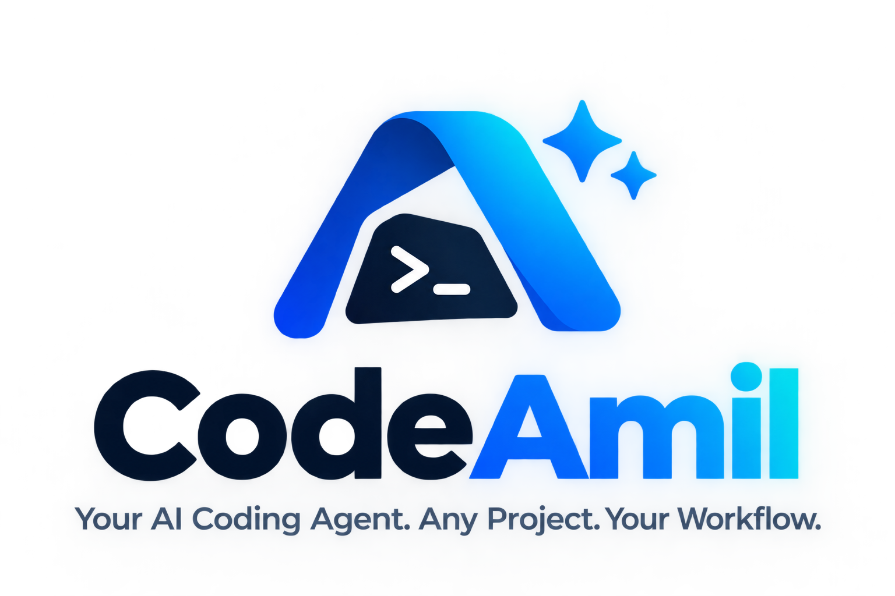

<div align="center">



# CodeAmil

### Your AI Coding Agent. Any Project. Your Workflow.

CodeAmil is a terminal-based Python AI coding agent that helps developers
inspect, modify, review, and verify real projects from the directory they are
already working in.

<p>
  <a href="https://github.com/emad313/codeamil">
    
  </a>
  
  
  <a href="LICENSE">
    
  </a>
  
</p>

**Read the code. Make the change. Check the result.**

</div>

CodeAmil uses the **current working directory as its default workspace**, so
the same command can work across different languages, frameworks, and
repositories. It gives an AI model carefully bounded file and command tools,
then keeps you in the loop before protected actions.

## ✨ At a glance

| Capability | What it provides |
| --- | --- |
| **Multi-provider AI** | Use Google Gemini, OpenAI, or OpenRouter with your chosen model. |
| **Workspace-aware tools** | List, read, search, and change files relative to the selected project. |
| **Approval gates** | Review proposed file changes and commands before they are applied or run. |
| **Code review** | Review selected files without modifying them, then optionally run an approval-gated review-fix loop. |
| **Python syntax QA** | Run deterministic syntax checks without a provider or API key. |
| **Terminal-first workflow** | Start from a project directory and get status, diffs, findings, and verification results in the terminal. |

## ⚡ Quick start

Install the latest code directly from GitHub:

```bash
python -m pip install git+https://github.com/emad313/codeamil.git
```

Configure a supported provider and its API key before running a model-powered
task:

```bash
codeamil config
```

Then start in the project you want CodeAmil to work on:

```bash
cd /path/to/your/project
codeamil "Explain the project structure"
```

`codeamil config` stores user settings in `~/.codeamil/.env`. A `.env` file in
the current workspace can override user-level settings, while already-exported
environment variables take precedence. Python syntax QA is the exception: it
does not require provider configuration.

## Contents

- [Features](#features)
- [Requirements](#requirements)
- [Installation](#installation)
- [Provider configuration](#provider-configuration)
- [CLI usage](#cli-usage)
- [Review, review-fix, and QA](#review-review-fix-and-qa)
- [Workspace and safety rules](#workspace-and-safety-rules)
- [Troubleshooting](#troubleshooting)
- [Development](#development)
- [License](#license)

## Features

### Work with the project in front of you

- Uses the directory where `codeamil` starts as the default workspace.
- Inspects project files and searches source text before acting.
- Works without assuming a particular language or framework.
- Keeps file-tool paths inside the selected workspace.

### Choose your model provider

CodeAmil supports:

- Google Gemini
- OpenAI
- OpenRouter

Select the provider and model ID in configuration; model availability depends
on the provider and your account.

### Keep changes reviewable

- File changes require explicit approval by default.
- Commands require explicit approval by default.
- Proposed file changes are shown as diffs before approval.
- Approved writes show the target file and its content line by line in the
  terminal.
- Tasks report provider errors, tool failures, iteration limits, and
  verification results instead of claiming success.

## Requirements

- Python 3.10 or newer
- `pip`
- Git, when installing directly from GitHub
- An API key for the selected provider when running model-powered tasks

## Installation

### Install from GitHub

```bash
python -m pip install git+https://github.com/emad313/codeamil.git
```

On Windows, the Python launcher can be used instead:

```powershell
py -m pip install git+https://github.com/emad313/codeamil.git
```

Verify the installation:

```bash
codeamil --version
codeamil --help
```

### Install from a cloned checkout

```bash
git clone https://github.com/emad313/codeamil.git
cd codeamil
python -m pip install -e .
```

The repository also includes an installer for a checked-out copy:

```powershell
py install.py
```

On macOS or Linux:

```bash
python3 install.py
```

### Use a virtual environment

Windows PowerShell:

```powershell
py -m venv .venv
.\.venv\Scripts\Activate.ps1
python -m pip install git+https://github.com/emad313/codeamil.git
```

macOS or Linux:

```bash
python3 -m venv .venv
source .venv/bin/activate
python -m pip install git+https://github.com/emad313/codeamil.git
```

## Provider configuration

The interactive command is the simplest setup:

```bash
codeamil config
```

It prompts for the provider, model ID, and API key, and writes settings to
`~/.codeamil/.env`. The supported variables are:

| Provider | `MODEL_PROVIDER` | API key |
| --- | --- | --- |
| Google Gemini | `gemini` | `GEMINI_API_KEY` |
| OpenAI | `openai` | `OPENAI_API_KEY` |
| OpenRouter | `openrouter` | `OPENROUTER_API_KEY` |

An equivalent `.env` configuration looks like this:

```dotenv
MODEL_PROVIDER=gemini
MODEL_ID=your-supported-model-id
GEMINI_API_KEY=your-api-key

MAX_AGENT_ITERATIONS=12
MAX_REVIEW_FIX_CYCLES=3
REQUIRE_APPROVAL_FOR_COMMANDS=true
REQUIRE_APPROVAL_FOR_FILE_CHANGES=true
REVIEW_FIX_MIN_SEVERITY=high
```

Use [`.env.example`](.env.example) as a reference. Never commit API keys or
other secrets to Git. Approval settings accept `true`, `false`, `1`, `0`,
`yes`, `no`, `on`, or `off`.

## CLI usage

Run a task from the project directory:

```bash
cd /path/to/your/project
codeamil "Inspect the project and explain its architecture"
```

If no task is supplied, CodeAmil prompts for one:

```bash
codeamil
```

Examples:

```bash
codeamil "Find and fix the bug in the authentication flow"
codeamil "Inspect the project and identify its main entry points"
codeamil "Add input validation to the registration endpoint"
codeamil "Run the relevant tests and report any failures"
```

General commands:

```bash
codeamil --help
codeamil --version
codeamil config
```

## Review, review-fix, and QA

Review selected files without applying changes:

```bash
codeamil --review app/main.py app/config.py
```

Review selected files and enter the approval-gated fix loop:

```bash
codeamil --review-fix app/main.py app/config.py
```

Run deterministic Python syntax checks:

```bash
codeamil --qa app/main.py app/config.py
```

QA can run without a provider or API key. Review and review-fix require a
configured provider. Review and QA return a non-zero exit status when the
requested operation fails or a check does not pass.

## Workspace and safety rules

- File-tool paths must remain inside the selected workspace.
- Directory listing and search skip symlink traversal.
- Ignored directories include `.git`, virtual environments, `node_modules`,
  caches, and Python bytecode caches.
- Commands run without invoking a shell.
- Shell launchers such as `cmd`, PowerShell, `bash`, and `sh` are blocked by
  command safeguards.
- Commands requiring approval are not executed until approved.
- Model-proposed file changes require approval by default.
- Read-only Git commands do not require approval; other commands follow the
  configured approval policy.

CodeAmil is not an operating-system sandbox. Approved programs run with your
user account's permissions and may access resources available to that account.
Inspect proposed diffs and understand commands before approving them. For
risky changes, use a disposable branch or test workspace.

## Troubleshooting

### `MODEL_ID must be configured`

Run `codeamil config` and configure a valid provider, model ID, and matching
API key. Python syntax QA does not require these settings.

### `Missing API key`

Check that the key matches the selected provider:

- Gemini: `GEMINI_API_KEY`
- OpenAI: `OPENAI_API_KEY`
- OpenRouter: `OPENROUTER_API_KEY`

Ensure the key is available in the environment or a local `.env` file. Never
paste keys into source code or commit them.

### `codeamil` is not recognized on Windows

Restart the terminal after installation. If the command is still unavailable,
check the installation and Scripts directory:

```powershell
py -m pip show codeamil
py -m pip --version
```

For a virtual environment:

```powershell
.\.venv\Scripts\python.exe -m pip show codeamil
.\.venv\Scripts\codeamil.exe --version
```

### The agent reaches its iteration limit

The model did not produce a final response before
`MAX_AGENT_ITERATIONS`. Inspect the reported tool results, increase the limit
modestly if appropriate, or split the task into smaller steps.

### A command or file change was not executed

Protected actions require approval by default. Review the proposed command or
diff and approve only what you understand:

```dotenv
REQUIRE_APPROVAL_FOR_COMMANDS=true
REQUIRE_APPROVAL_FOR_FILE_CHANGES=true
```

### Provider requests fail or time out

Check the provider, model ID, API key, account access, quota, and network
connection. CodeAmil reports failures after its bounded retry behavior rather
than presenting them as successful tasks.

## Development

Clone the repository and create an editable environment:

```bash
git clone https://github.com/emad313/codeamil.git
cd codeamil
python -m venv .venv
python -m pip install -e .
```

Activate the environment first when needed:

Windows PowerShell:

```powershell
.\.venv\Scripts\Activate.ps1
```

macOS or Linux:

```bash
source .venv/bin/activate
```

Run the repository checks:

```bash
python -m compileall -q app tests
python -m pytest -q
```

Most regression tests use controlled test doubles and temporary workspaces;
they do not require live provider API calls.

## License

CodeAmil is licensed under the MIT License. See [LICENSE](LICENSE) for the
full license text.

Copyright (c) 2026 Emad Uddin.

## Repository

[github.com/emad313/codeamil](https://github.com/emad313/codeamil)
